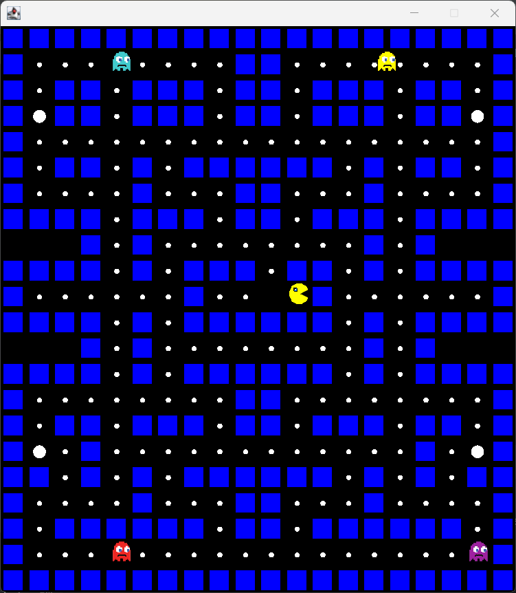
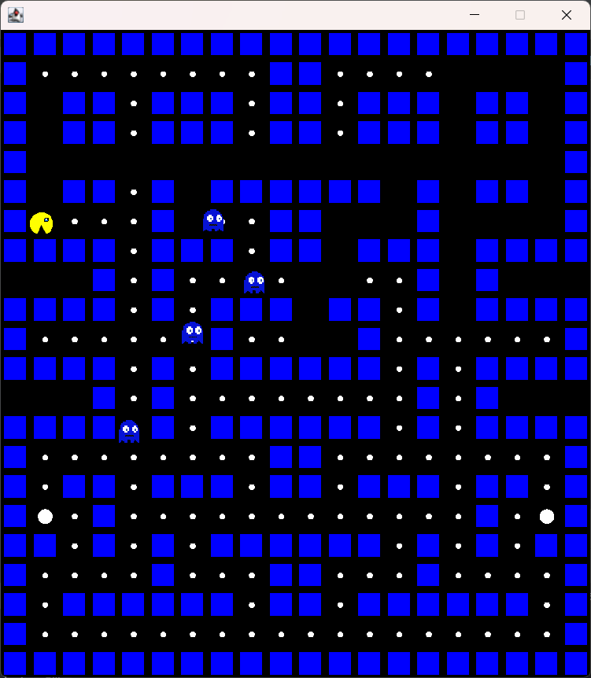

# Pac-Man

A classic Pac-Man clone built from scratch in **Java** with **Swing**. Features a hand-crafted maze, dot collection, power pellets, and four ghosts — each with its own distinct chasing strategy inspired by the original arcade game.




## Features

- **Grid-based maze** rendered from a 2D map (walls, dots, power pellets, ghost gate).
- **Four ghosts with unique AI** — each uses its own targeting logic (see below).
- **Power pellets** put ghosts into a *frightened* mode where they can be eaten.
- **Respawn mechanics** — eaten ghosts return to their starting tile after a short delay.
- **Win / lose states** — clear all dots to win, get caught to lose.

## Ghost Behavior

Each ghost implements a different pursuit strategy, mirroring the personalities from the original Pac-Man:

| Ghost       | Strategy                                                            |
|-------------|--------------------------------------------------------------------|
| 🔴 Red      | Chases Pac-Man directly (targets his current tile).                |
| 🟦 Turquoise| Targets the tile 4 steps ahead of Pac-Man.                         |
| 🟣 Purple   | Combines Red's position with a point 2 tiles ahead of Pac-Man.     |
| 🟡 Yellow   | Chases when far away, retreats toward home when it gets too close. |

## Controls

| Key            | Action        |
|----------------|---------------|
| `↑` `↓` `←` `→`| Move Pac-Man  |

## Getting Started

### Prerequisites

- **JDK 8 or newer** installed and on your `PATH` (`java -version` to check).

### Build & Run

Run these commands from the project root (the `Pacman/` folder). The working directory matters, because image assets are loaded relative to it.

```bash
# Compile the sources into the bin/ folder
javac -d bin src/main/java_files/*.java

# Launch the game
java -cp bin main.java_files.Luncher
```

You can also open the project directly in **IntelliJ IDEA** or **VS Code** and run the `Luncher` class.

## Project Structure

```
Pacman/
├── src/main/
│   ├── java_files/        # Game source code
│   │   ├── Luncher.java       # Entry point (JFrame setup)
│   │   ├── GamePanel.java     # Game loop, rendering, collision, input
│   │   ├── Character.java     # Base class for movable entities
│   │   ├── Pacman.java        # Player character
│   │   ├── Ghost.java         # Abstract ghost (shared logic)
│   │   ├── RedGhost.java      # Direct chase
│   │   ├── TurquiseGhost.java # Ambush ahead
│   │   ├── PurpleGhost.java   # Combined targeting
│   │   └── YellowGhost.java   # Chase / retreat
│   └── resources/         # Sprites (Pac-Man, ghosts, win/lose screens)
└── lib/                   # Third-party dependencies (SQLite JDBC)
```

## Tech Stack

- **Java** — core language
- **Swing / AWT** — rendering, input handling, and the game window
- **SQLite JDBC** — bundled for a planned high-score feature (see Roadmap)

